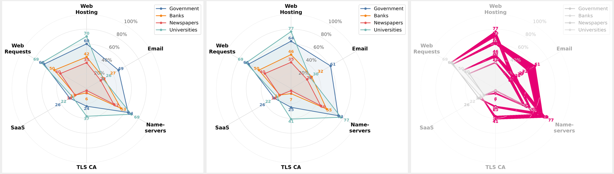

## EU Digital Sovereignty in Practice: A Technical Assessment of Digital Infrastructure Dependencies

### Data and scripts for reproduction:

#### domain lists (study_domains: GOV + EU)

```
domains/
banks.json		
newspapers.json		
study_domains.json 
universities.json
```

#### patterns and definitions 

```
lookup_tables/ 
ca_database.csv
cloud_providers.csv
mx_patterns.csv
provider_overrides.csv
txt_patterns.csv
```

#### data and post_processed results

```
raw_data/	
results/
```

#### scanning scripts & visualisation code

```
scanner/
visualization/
```

#### Web Content reproducibility artifact

The code, compact crawl databases, reference outputs, and the manuscript's Web
Content section are provided under [`web_content/`](web_content/).
From that directory, run:

```bash
python3 -m venv .venv
.venv/bin/pip install -r analysis/requirements.txt
.venv/bin/python analysis/reproduce.py
```

Large screenshot and HAR archives are not included in this repository and are
available from the authors on request.

### Errata

- Scoring unknowns (`474fc4f`): Markus „fin“ Hametner, while working with the data correctly pointed out that in calculating our score, the underlying set is not always the number of domains, but the number of domains without errors. He also helped us improve the total unkowns in the dimension of NS. Later will be corrected in the Oct collection and released here.

